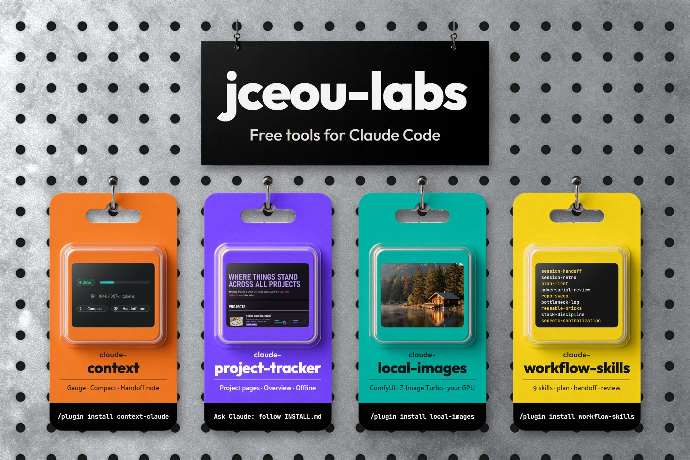

<p align="center">
  
</p>

Free, open-source tools for [Claude Code](https://claude.com/claude-code), built and used day to day on real
projects. Each one works on its own.

| Tool | What it does |
|---|---|
| **[claude-context](https://github.com/jceou-labs/claude-context)** | A slim gauge above the prompt showing how close the context is to auto-compaction, with Compact and Handoff note buttons. |
| **[claude-project-tracker](https://github.com/jceou-labs/claude-project-tracker)** | Offline pages showing where each project stands (done, remaining, waiting for you), kept up to date by Claude. |
| **[claude-local-images](https://github.com/jceou-labs/claude-local-images)** | Lets Claude generate images on your own graphics card with ComfyUI and Z-Image Turbo: free, unlimited, private. Tested on Windows with an NVIDIA card so far. |
| **[claude-workflow-skills](https://github.com/jceou-labs/claude-workflow-skills)** | Nine skills that keep long work on track: plan on disk, session handoffs, adversarial review, repository sweeps, recurring friction fixed for good. |

### Install

Three of the tools are plugins: type their line at the prompt of a Claude Code terminal session. In the Claude
desktop app, where `/plugin` doesn't run, click + next to the prompt box, then Plugins, Add marketplace with the
repository name (for example `jceou-labs/claude-context`), then Add plugin.

**claude-context**

```
/plugin install context-claude --marketplace jceou-labs/claude-context
```

**claude-project-tracker** is a folder, not a plugin. Clone it in a terminal, then open Claude Code in that folder
and say "Install the project tracker in this folder by following INSTALL.md."

```
git clone https://github.com/jceou-labs/claude-project-tracker
```

**claude-local-images**

```
/plugin install local-images --marketplace jceou-labs/claude-local-images
```

**claude-workflow-skills**

```
/plugin install workflow-skills --marketplace jceou-labs/claude-workflow-skills
```

Each repository's README has the full steps.

### In use

**claude-context**: the gauge above the prompt, with its Compact and Handoff note buttons.

<p>
  
</p>

<table>
  <tr>
    <td width="50%" valign="top"><b>claude-project-tracker</b>: the overview page, all projects at a glance.</td>
    <td width="50%" valign="top"><b>claude-local-images</b>: an image generated on a local graphics card.</td>
  </tr>
  <tr>
    <td valign="top"></td>
    <td valign="top"></td>
  </tr>
</table>

All under the MIT license. Issues and suggestions are welcome on each repository.
